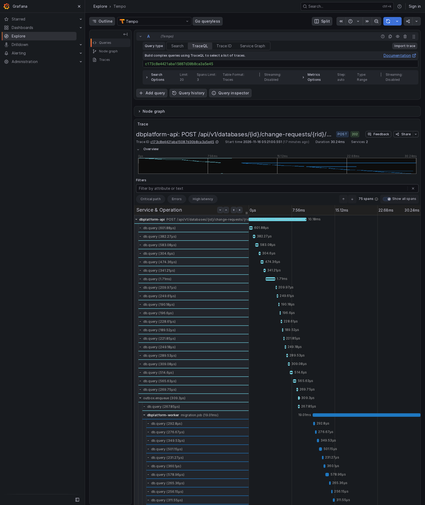
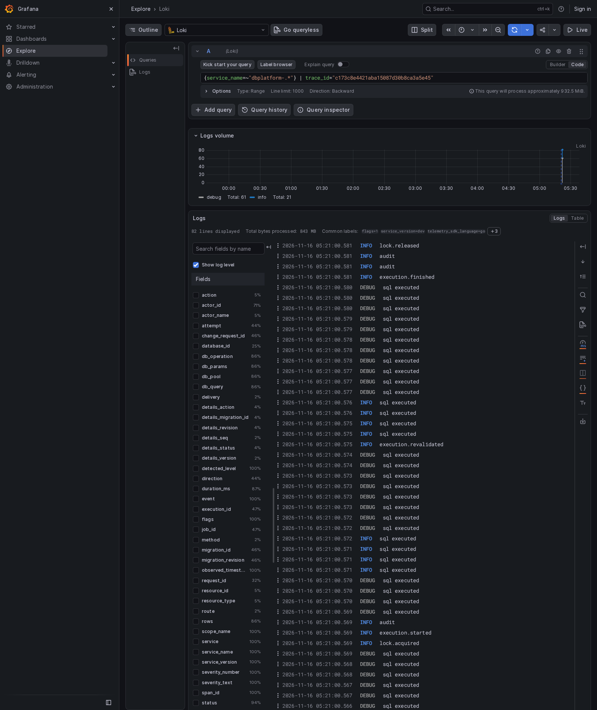
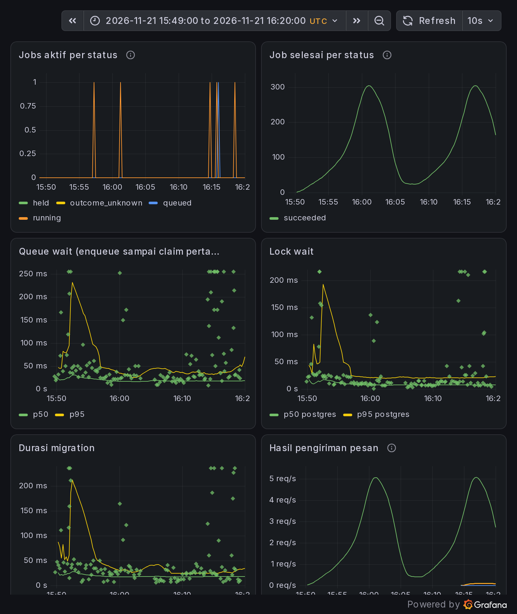
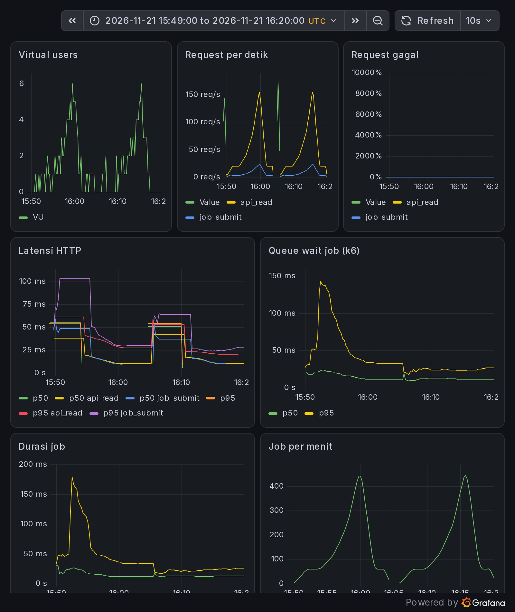
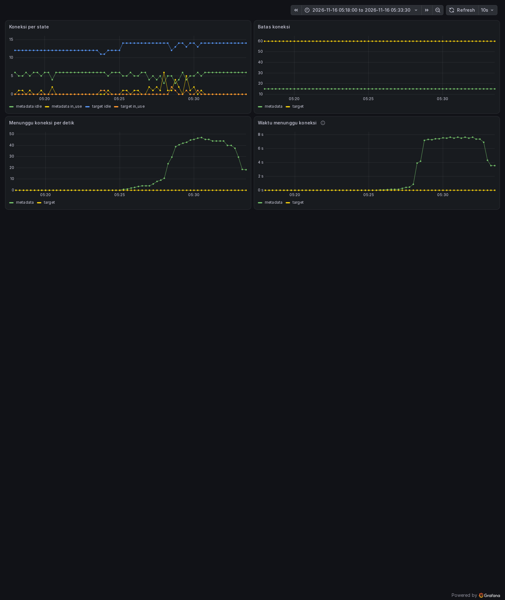
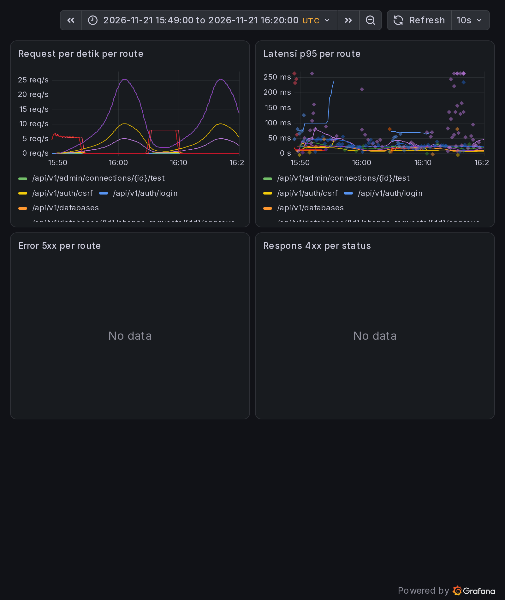
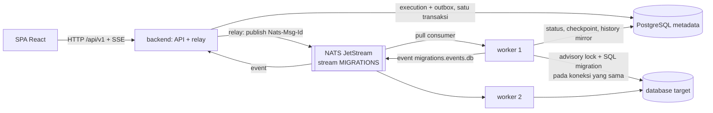

# IF3110_K01_G03

Aplikasi web untuk **mengelola akses database, menelusuri schema dan data, serta membuat dan menjalankan migrasi SQL secara terkontrol dan memiliki riwayat**.

Admin mendaftarkan database target (PostgreSQL atau SQLite) dan memberi hak akses per database melalui group. Pengguna hanya melihat database yang boleh mereka akses:

- dengan akses **lihat**, pengguna dapat membaca schema, data, dan riwayat migrasi;
- dengan akses **edit**, pengguna juga dapat membandingkan schema dan menyiapkan perubahan.

> **Status Milestone 2.** Runner migrasi sinkron Milestone 1 (draft, run, ledger target) sudah dihapus. Penggantinya adalah alur migration dengan review, approval leader, queue, dan worker, yang sedang dibangun di atas schema metadata `0005`–`0008` dan tabel riwayat target `_platform.migration_history`. Target dari Milestone 1 yang masih memiliki `_platform.migration_ledger` ditolak dengan `LEDGER_INCOMPATIBLE`; reset volume development sekali dengan `sh scripts/dev-up.sh down -v`.

## Fitur

| Fitur | Keterangan |
|---|---|
| Autentikasi | Login username/password (hash Argon2id), session opaque di backend lewat cookie HttpOnly, rotasi, masa berlaku, logout/revoke, proteksi CSRF |
| Otorisasi | Hak `lihat`/`edit` per database melalui group; hak efektif adalah yang tertinggi dari semua group pengguna. Admin platform terpisah dari akses ke target |
| Registry koneksi | Admin mendaftarkan, mengubah, menguji, dan menonaktifkan koneksi. Kredensial disimpan terenkripsi (AES-GCM) dan tidak pernah dikirim ke browser |
| Viewer | Schema, tabel, kolom, constraint, indeks, dan data dengan pagination. Nilai `NULL`, bigint besar, desimal, dan biner ditampilkan tanpa kehilangan makna |
| Bonus: SQLite | Viewer, perbandingan schema, dan kontrol akses juga berjalan untuk SQLite |
| Bonus: EXPLAIN | Analisis rencana eksekusi satu statement (mode estimasi, tanpa `ANALYZE`) untuk PostgreSQL dan SQLite |

### Session

Login yang berhasil membuat session di backend; browser hanya menerima token acak 32 byte di cookie `session` (HttpOnly, SameSite=Lax, Secure di production/HTTPS). Database hanya menyimpan hash token. Session diperiksa pada setiap request ke halaman dan API yang dilindungi.

| Pengaturan | Default | Variabel `.env` | Perilaku |
|---|---|---|---|
| Idle timeout | 30 menit | `SESSION_IDLE_TIMEOUT` | Session berakhir bila tidak ada request selama durasi ini. Setiap request yang valid memperbarui waktu aktivitas terakhir |
| Absolute expiration | 8 jam | `SESSION_ABSOLUTE_TIMEOUT` | Dihitung sejak login. Setelah lewat, pengguna harus login ulang walaupun masih aktif |
| Interval rotasi | 15 menit | `SESSION_ROTATION_INTERVAL` | Request pertama setelah interval ini mendapat token baru dengan nama cookie yang sama |
| Grace period | 30 detik | `SESSION_GRACE_PERIOD` | Token lama tetap diterima selama durasi ini setelah rotasi, untuk response yang tidak sampai atau request yang berjalan bersamaan. Setelah itu token lama ditolak |

Alasan pemilihan nilai:

- **Idle 30 menit:** cukup panjang untuk menyusun dan meninjau migrasi tanpa terputus, tetapi membatasi risiko dari browser yang ditinggalkan.
- **Absolute 8 jam:** kira-kira satu hari kerja, jadi pengguna login ulang setidaknya sekali sehari.
- **Rotasi 15 menit:** token yang bocor hanya berguna dalam jendela waktu yang pendek.
- **Grace 30 detik:** cukup untuk request paralel dan jaringan lambat, tetapi terlalu singkat untuk dipakai ulang oleh penyerang.

Aturan tambahan:

- Token juga dirotasi saat login, karena session pra-login (dipakai hanya untuk CSRF, berlaku 10 menit) dicabut dan diganti session baru. Rotasi juga terjadi pada request berikutnya setelah hak akses naik, yaitu ketika grant baru diberikan, level naik ke `edit`, pengguna ditambahkan ke group, atau data pengguna diubah oleh admin.
- Rotasi tidak memperpanjang absolute expiration. Batas ini dikunci oleh trigger database, dan grace period tidak pernah melewatinya.
- Session langsung dinonaktifkan di backend saat logout, saat level turun dari `edit` ke `view`, saat grant dicabut, saat pengguna dikeluarkan dari group, saat group dihapus, saat password direset, saat pengguna dinonaktifkan, saat hak admin dicabut, dan saat koneksi database dinonaktifkan.
- Nilai di `.env` memakai format durasi Go (misalnya `45m`, `12h`, `10s`) dan harus positif.

## Teknologi

| Bagian | Teknologi |
|---|---|
| Backend | Go 1.27.2, `net/http` standard library, `html/template` untuk halaman |
| Frontend | SPA React 19 + Vite, TanStack Router (file-based) dan TanStack Query, Tailwind CSS v4 + shadcn/ui (Radix), client `openapi-fetch` dengan tipe hasil generate dari `api/openapi.yaml` |
| Database | PostgreSQL 17.11 (metadata aplikasi dan target), SQLite (target tambahan) |
| Driver | pgx v5, go-sqlite3 (butuh CGO), pg_query_go untuk mem-parse SQL PostgreSQL |
| Queue | NATS 2.15.2 dengan JetStream (file storage), port host `127.0.0.1:14222` |
| Logging | `log/slog` JSON ke stdout dengan redaksi kunci sensitif serta `request_id`, `actor_id`, `trace_id`, `span_id`; level lewat `LOG_LEVEL` |
| Runtime | Docker Compose; image dibangun mengikuti arsitektur host |

## Prasyarat

- **Docker Desktop** (atau Docker Engine dengan Compose v2).
- **Shell POSIX** untuk menjalankan script di `scripts/`. Di Windows gunakan **Git Bash**.
- Go 1.27.2 (dengan compiler C untuk CGO) dan Node.js 24.22.0 hanya diperlukan untuk mode development di host. Test dan build berjalan di container.

## Menjalankan aplikasi

Dari root repository:

```sh
sh scripts/init-env.sh      # buat .env dan isi secret lokal secara acak
sh scripts/dev-up.sh        # nyalakan PostgreSQL metadata dan target, serta NATS JetStream
sh scripts/app-up.sh seed   # build image, migrasi metadata, isi data demo, jalankan aplikasi
```

Buka http://localhost:8080.

- `init-env.sh` hanya mengisi kunci yang masih kosong, jadi aman dijalankan ulang dan tidak menimpa nilai yang sudah Anda isi.
- `.env` berisi secret lokal: jangan di-commit dan jangan dibagikan. Setiap anggota membuat `.env` sendiri.
- Tanpa argumen `seed`, `app-up.sh` hanya build, migrasi, dan menjalankan aplikasi.

### Akun dan data demo

`app-up.sh seed` membuat akun `fixture-admin` (admin platform), `editor`, `viewer`, `outsider`, dan `lead`, beserta tiga group dengan leader (`viewer` memimpin readers; `lead` memimpin writers dan ops), hak akses, dan sembilan koneksi. Daftar koneksi harus berisi empat koneksi demo, `demo_big`, dan `load_1..4`; group ops mendapat akses edit ke lima yang terakhir. Bila `tmp/connections.local.json` Anda masih berisi empat entri, hapus file itu lalu jalankan `scripts/init-env.sh`. Password semua akun demo adalah nilai `FIXTURE_PASSWORD` di `.env` Anda.

`seed` mengisi file SQLite `demo.sqlite` serta pembanding `demo_desired.sqlite`, dan membuat/mengisi PostgreSQL `demo_desired`. Target yang sudah memiliki objek, termasuk riwayat migrasi, dilewati. File SQLite yang sudah ada tetapi masih kosong dapat diisi dalam satu transaksi. Data dan riwayat migrasi tetap tersimpan saat `seed` dijalankan ulang.

Kedua pembanding memakai schema dasar demo, lalu menambahkan `items.status`, index `items_status_idx`, dan tabel `item_tags`. Fixture dasarnya ada di `tests/fixtures/{postgres,sqlite}/demo.sql`; tambahan pembanding ada di `desired.sql` pada folder yang sama. Database lama yang sudah berisi pekerjaan tidak otomatis diubah agar mengikuti fixture baru.

Menjalankan `seed` ulang mencabut session akun demo, jadi login kembali setelahnya.

Untuk mengatur akses database, buka Administrasi → Grup → Hak akses pada grup yang dipilih. Pilih database dan level `view` atau `edit`; grant yang sudah ada dapat diubah atau dicabut. Penurunan `edit` ke `view` dan pencabutan grant mengakhiri seluruh sesi anggota grup, termasuk admin yang menjadi anggota.

Sebelum sebuah koneksi dipakai sebagai source perbandingan atau target migrasi, admin harus **menguji koneksi itu terlebih dahulu** di halaman Koneksi. Pengujian menyiapkan tabel riwayat migrasi di target; sampai diuji, operasi tersebut menjawab `TARGET_NOT_READY`.

### Perbandingan schema

Pengguna dengan akses edit dapat membuka **Bandingkan schema** dari halaman database, atau langsung ke `/databases/{id}/schema-diff`. Halaman dirender Go dan dapat dibuka lewat URL/refresh biasa; JavaScript menangani interaksi di halaman tersebut tanpa router klien.

1. Admin menguji koneksi source terlebih dahulu. Pembanding cukup memiliki akses view dan tidak memerlukan tabel riwayat.
2. Pilih database pembanding sejenis dan schema, lalu tekan **Bandingkan schema**.
3. Tinjau daftar perubahan, penanda destruktif, warning, dan kandidat SQL (hanya baca).

Schema identik atau perubahan unsupported tidak menampilkan kandidat kosong/parsial. Mengubah pilihan menandai hasil lama sebagai usang. Sesi kedaluwarsa menampilkan tautan login di tab baru; perbandingan lalu diulang secara manual.

### API schema diff

`POST /api/v1/databases/{id}/schema-diff` memerlukan session, CSRF, izin edit pada source, dan view pada pembanding. Source harus sudah diuji admin; pembanding tidak memerlukan tabel riwayat. Engine kedua database harus sama. Gunakan schema `public` untuk demo PostgreSQL atau `main` untuk SQLite.

Setelah login sebagai `editor`, contoh berikut dapat dijalankan dari console browser pada aplikasi lokal:

```js
const { data: { csrf_token } } = await fetch('/api/v1/auth/csrf').then(r => r.json());
const result = await fetch('/api/v1/databases/30000000-0000-4000-8000-000000000001/schema-diff', {
  method: 'POST',
  headers: { 'Content-Type': 'application/json', 'X-CSRF-Token': csrf_token },
  body: JSON.stringify({
    desired_database_id: '30000000-0000-4000-8000-000000000003',
    schema: 'public',
  }),
}).then(r => r.json());
console.log(result);
```

Respons berisi `changes`, `warnings`, `candidate_sql`, `executable`, `expected_version`, serta fingerprint source/pembanding. Diff tidak menjalankan kandidat dan tidak menulis metadata. Kandidat non-executable selalu kosong. `expected_version` adalah head riwayat migrasi source saat dibandingkan.

`DIFF_TIMEOUT` membatasi perbandingan (default `30s`). Capability `schema_diff` aktif untuk SQLite; PostgreSQL memerlukan probe Atlas Community v1.3.0 yang berhasil saat startup. `ATLAS_BIN` kosong memakai `atlas` dari PATH; image aplikasi sudah menyertakan binary tersebut. Atlas yang hilang menonaktifkan capability PostgreSQL dan menghasilkan `DIFF_UNAVAILABLE` bila endpoint dipanggil. Rincian ada di [petunjuk Atlas](infra/atlas/README.md).

Di dalam Compose, aplikasi mencapai PostgreSQL target sebagai `target-postgres` port `5432`. Gunakan alamat ini saat mendaftarkan koneksi baru lewat halaman Koneksi.

### Menghentikan

```sh
sh scripts/dev-up.sh --profile app down      # hentikan semua container, data tetap ada
sh scripts/dev-up.sh --profile app down -v   # hentikan dan HAPUS seluruh data
```

## Development di host

Untuk mengubah kode tanpa membangun ulang image. Jalankan database dengan `scripts/dev-up.sh`, lalu:

```sh
# backend: build lalu jalankan dari root repository
(cd backend && go build -o bin/ ./cmd/server ./cmd/migrate ./cmd/seed)
set -a; . ./.env; set +a
./backend/bin/migrate up
./backend/bin/seed fixtures   # opsional: data demo
./backend/bin/server

# frontend: di terminal lain, Vite dev server (http://localhost:5173) mem-proxy /api ke backend :8080
cd web && npm ci && npm run dev
# setelah api/openapi.yaml berubah: npm run gen:api (tipe src/api/schema.d.ts di-commit)
```

Server membaca daftar asset hasil build saat start. Restart server setelah build frontend pertama kali dan setelah menambah entry halaman baru.

## Pemulihan lock migration

Setiap database target menjalankan paling banyak satu migration. Worker mengambil *session advisory lock* di database target itu sendiri, pada satu koneksi yang juga menjalankan semua transaksi eksekusinya; database berbeda berjalan paralel. Unique index `running` per database di metadata menjadi pengaman kedua.

| Kegagalan | Pemulihan |
|---|---|
| Proses worker crash atau di-kill | OS menutup socket, backend PostgreSQL berakhir seketika, advisory lock lepas, dan transaksi batch yang terbuka di-rollback |
| Host atau jaringan worker putus | Target PostgreSQL di Compose memakai `tcp_keepalives_idle=10`, `interval=5`, `count=3`, sehingga sesi mati berakhir dalam ±25 detik. Worker itu mendeteksi koneksi lock gagal (ping 5 detik) lalu berhenti; ia tidak mungkin commit karena transaksinya ada di koneksi yang sama |
| Pesan tidak di-ack | Selama handler hidup, worker mengirim `InProgress` setiap `JOB_ACK_WAIT/3`. Bila berhenti, JetStream mengirim ulang pesan setelah `JOB_ACK_WAIT` ke worker lain |
| Pengambilalihan | Worker yang berhasil mengambil lock tahu pemegang lama pasti sudah berakhir, lalu memeriksa bukti commit di target (history/checkpoint) sebelum melanjutkan dari checkpoint |
| Pesan hilang (stream dipurge) | Sweeper di worker menerbitkan ulang execution yang basi dari metadata setiap 30 detik |

SQLite memakai advisory lock pada koneksi metadata yang dipin (lepas bila worker mati) dan `BEGIN IMMEDIATE`.

## Logging dan tracing

API dan worker menulis log JSON ke stdout dan trace OpenTelemetry ke exporter console (`OTEL_TRACES_EXPORTER=console`, default). Satu eksekusi menjadi satu trace dari request HTTP sampai SQL di target:

```text
POST /api/v1/databases/{id}/change-requests/{rid}/execute   (API, server)
 └─ outbox.enqueue                                           (traceparent ikut disimpan di outbox)
     └─ migration.job                                        (worker, consumer; parent dari pesan NATS)
         ├─ lock.acquire          outcome, wait_ms
         ├─ execution.revalidate
         ├─ db.query              SQL migration, history target, COMMIT pada koneksi lock
         └─ execution.finalize
outbox.publish                                               (relay, producer; trace sendiri dengan link ke outbox.enqueue)
```

- Setiap query PostgreSQL (metadata dan target, termasuk read-only) menjadi span `db.query` dengan `db.pool`, `db.operation`, `db.query`, tipe `db.params`, `rows`, dan `sqlstate` bila gagal; SQLite memakai format yang sama. Query target juga dicatat sebagai log `db.query`/`db.tx.*` level INFO, metadata level DEBUG.
- SQL yang ditulis pengguna dinormalisasi sebelum dicatat (literal menjadi `$n`), dan nilai parameter tidak pernah dicatat, hanya tipenya.
- Log yang ditulis selama span aktif membawa `trace_id` dan `span_id` span itu, sehingga log worker dapat dicari dari trace dan sebaliknya.

Contoh output nyata (pohon span lengkap, span `lock.acquire` dan `db.query`, serta log yang berkorelasi) ada di [`docs/observability/spans.md`](docs/observability/spans.md).

## Observability (bonus)

```sh
sh scripts/obs-up.sh        # collector, Loki, Tempo, Prometheus, Grafana; API dan worker mengirim trace + log via OTLP
sh scripts/obs-up.sh down   # matikan stack; aplikasi kembali ke trace console
```

- Grafana `http://localhost:3000` (anonim, hanya localhost): dashboard *Migration queue*, *Database pools*, *API HTTP*, *Load test (k6)* dan datasource terprovision otomatis.
- Prometheus `http://localhost:9090` men-scrape `/metrics` API dan setiap replika worker di jaringan Compose (port 9464 tidak dibuka ke host).
- Korelasi: exemplar `trace_id` pada histogram → trace di Tempo → log di Loki dengan `trace_id` yang sama (`{service_name="dbplatform-worker"} | trace_id="<id>"`), dan sebaliknya dari log ke trace.
- Tanpa stack ini, log JSON tetap ke stdout dan trace dicetak exporter console.

Contoh korelasi dari run nyata: request execute dengan `trace_id` `c173c8e4421aba15087d30b8ca3a5e45` (stress test 16 November 2026) dibuka di Tempo sebagai satu trace dari `dbplatform-api` sampai `dbplatform-worker` (75 span), lalu query Loki `{service_name=~"dbplatform-.*"} | trace_id="c173c8e4421aba15087d30b8ca3a5e45"` menampilkan 82 baris log API dan worker untuk trace yang sama (dari `execution.enqueued` sampai `lock.released`). Arah metrik → trace memakai exemplar: `/metrics` disajikan dalam format OpenMetrics sehingga setiap observasi histogram membawa `trace_id`. Pada smoke 17 November 2026, exemplar `migration_duration_seconds` dengan `trace_id` `89fb4925f875342c9205457d796163b0` (salah satu titik belah ketupat di panel *Durasi migration*) mengarah ke trace execute → worker lengkap (77 span) di Tempo; datasource Prometheus terprovision memetakan label `trace_id` exemplar ke Tempo.

| Trace di Tempo | Log trace yang sama di Loki |
|---|---|
|  |  |

Dashboard terprovision:

- *Migration queue* (k6 smoke, 17 November 2026): job aktif per status, job selesai, queue wait, lock wait, durasi (titik belah ketupat adalah exemplar), dan alasan pengiriman pesan. 
- *Load test (k6)* (stress tersebar, 16 November 2026). Lonjakan "Request gagal" di awal adalah nilai terakhir dari run smoke sebelumnya yang belum kedaluwarsa, bukan bagian run ini. 
- *Database pools* dan *API HTTP* (stress tersebar yang sama).  

## Stress test k6 (bonus)

```sh
EDITOR_PASSWORD=<FIXTURE_PASSWORD> sh scripts/load-test.sh -e PROFILE=smoke   # 1 menit, beban rendah
EDITOR_PASSWORD=<FIXTURE_PASSWORD> sh scripts/load-test.sh                    # 14 menit, job tersebar di load_1..load_4
EDITOR_PASSWORD=<FIXTURE_PASSWORD> sh scripts/load-test.sh -e TARGETS=same    # semua job di load_1
```

Beban normal: 20 request baca/detik + 1 job/detik (`READ_RPS`, `JOB_RPS`). Tahapan: naik ke normal 2 menit, tahan 2 menit, naik ke 2×, 4×, 8× masing-masing 2 menit, turun ke normal 2 menit, tahan 2 menit. `setup()` menyiapkan migration dan change request yang sudah di-approve; skenario `job_submit` hanya menekan execute lalu menunggu status akhir (202 bukan berarti sukses). Threshold: p95 baca < 300 ms, p95 execute < 500 ms, request gagal < 1%, checks > 99%. Hasil dikirim ke Prometheus (dashboard *Load test (k6)*).

`setup()` login sebagai `fixture-admin` untuk menguji koneksi `load_1..4` (menyiapkan tabel riwayat), lalu sebagai `lead` (satu-satunya pengguna dengan akses edit, sekaligus leader group ops) membuat dan meng-approve migration. Ganti dengan `ADMIN_USER`/`ADMIN_PASSWORD` dan `EDITOR_USER`/`LEADER_USER` bila akun lain dipakai.

#### Hasil (16 November 2026)

Mesin: Intel Core i9-13900H, RAM 32 GB, Windows 11 + Docker Desktop (WSL2, 20 vCPU dan 15,5 GB untuk Docker). API satu replika, worker dua replika (`WORKER_CONCURRENCY=4`), semua service di mesin yang sama dengan k6. Angka per tahap dihitung dari metrik server (`http_server_request_duration_seconds`, `migration_*`) dengan jendela 2 menit di akhir setiap tahap; tahap "naik" mencatat beban yang sedang menuju target.

Ringkasan k6 untuk seluruh run:

| Run | Request | Gagal | Checks | Job sukses / gagal | p95 baca | p95 execute | Queue wait p50 / p95 | Iterasi terbuang (VU habis) |
|---|---|---|---|---|---|---|---|---|
| Tersebar (`load_1..4`) | 56.471 | 0% | 100% | 2.086 / 0 | 61,7 ms | 83,6 ms | 15 ms / 2,0 s | 864 |
| Satu DB (`TARGETS=same`) | 235.104 | 0% | 100% | 1.338 / 0 | 191,8 ms | 131,2 ms | 3,0 s / 199,5 s | 855 |

Job tersebar di empat database:

| Tahap (2 menit) | API baca p50 / p95 (ms) | execute p95 (ms) | Throughput (req/s) | Error 5xx | Queue wait p50 / p95 (ms) | Lock wait p95 (ms) | Durasi job p50 / p95 (ms) | Job sukses/menit |
|---|---|---|---|---|---|---|---|---|
| 0 → 1× | 15,9 / 24,6 | 23,7 | 12,3 | 0% | 16,4 / 24,4 | 9,9 | 17,0 / 24,5 | 30 |
| 1× tahan | 16,0 / 24,3 | 24,2 | 23,0 | 0% | 17,3 / 24,6 | 18,8 | 17,0 / 24,5 | 59 |
| 1× → 2× | 14,6 / 24,4 | 33,6 | 34,3 | 0% | 17,4 / 27,3 | 20,2 | 16,7 / 31,2 | 90 |
| 2× → 4× | 9,7 / 39,7 | 51,7 | 69,0 | 0% | 19,1 / 46,8 | 24,2 | 19,2 / 46,2 | 179 |
| 4× → 8× | 9,2 / 192 | 455 | 144,2 | 0% | 23,0 / 2.261 | 23,3 | 18,6 / 44,0 | 352 |
| 8× → 1× | 9,1 / 33,4 | 55,2 | 110,6 | 0% | 1.026 / 2.353 | 23,1 | 18,7 / 43,3 | 279 |
| 1× pemulihan | 14,5 / 29,7 | 42,7 | 23,0 | 0% | 17,8 / 42,1 | 21,9 | 18,0 / 37,9 | 59 |

Semua job di `load_1`:

| Tahap (2 menit) | API baca p50 / p95 (ms) | execute p95 (ms) | Throughput (req/s) | Error 5xx | Queue wait p50 / p95 (ms) | Lock wait p95 (ms) | Durasi job p50 / p95 (ms) | Job sukses/menit |
|---|---|---|---|---|---|---|---|---|
| 0 → 1× | 15,2 / 33,2 | 29,2 | 11,7 | 0% | 19,0 / 43,0 | 24,2 | 18,6 / 40,0 | 31 |
| 1× tahan | 15,0 / 24,8 | 42,0 | 23,0 | 0% | 19,5 / 44,1 | 22,4 | 19,0 / 43,5 | 59 |
| 1× → 2× | 13,5 / 28,8 | 47,2 | 33,4 | 0% | 19,4 / 47,3 | 24,0 | 19,8 / 44,7 | 89 |
| 2× → 4× | 9,0 / 25,0 | 54,3 | 75,4 | 0% | 1.838 / 4.506 | 23,0 | 19,0 / 46,1 | 175 |
| 4× → 8× | 8,9 / 96,1 | 71,1 | 258,0 | 0% | 9.429 / 46.235 | 49,6 | 22,5 / 79,0 | 170 |
| 8× → 1× | 24,8 / 446 | 223 | 662,3 | 0% | 89.610 / 240.706 | 94,9 | 73,1 / 97,3 | 61 |
| 1× pemulihan | 25,1 / 860 | 875 | 658,7 | 0% | 210.000 / 291.000 | 91,6 | 70,8 / 97,1 | 64 |

#### Analisis

- **Eksekusi SQL bukan bottleneck.** Durasi job tetap ±20 ms (p95 < 50 ms) sampai 8× pada run tersebar, dan lock wait p95 tetap < 25 ms. Respons execute (202) tidak bergantung pada durasi migration.
- **Database berbeda berjalan paralel, database sama berurutan.** Pada run tersebar terdapat 104 pasang eksekusi di database berbeda yang rentang `running`-nya overlap; pada kedua run tidak ada satu pun pasangan `running` yang overlap di database yang sama. Queue wait satu DB (p50 3,0 s) jauh di atas run tersebar (p50 15 ms).
- **Batas pertama: pool metadata API.** Pool metadata API dibatasi 5 koneksi. Pada 8× pool itu menunggu 8.298 kali (total 1.290 detik dalam 2 menit), sehingga p95 baca naik ke 192 ms dan p95 execute ke 455 ms; pool target dan pool worker tidak pernah menunggu. Menaikkan batas pool metadata API adalah langkah pertama bila beban lebih besar dibutuhkan.
- **Batas kedua: urutan job dalam satu database.** Job berikutnya di database yang sama di-NAK dengan jeda `ORDERING_DELAY` (1 s) selama job sebelumnya belum selesai. Dengan empat database, redelivery `ordering` hanya ratusan per 2 menit dan antrean pulih setelah beban turun. Dengan satu database, kapasitas mentok di ±170 job/menit; begitu kedatangan melampaui itu (4×), antrean tumbuh dan setiap job yang menunggu dikirim ulang setiap detik. Pada 8× → 1× tercatat ±23.800 redelivery `ordering` per 2 menit dibanding 128 job selesai, sehingga throughput justru turun ke ±60 job/menit. Polling status oleh 400 VU k6 (setiap 0,5 detik) menambah beban ke pool metadata API (8.728 detik total tunggu dalam 2 menit), yang menaikkan p95 baca ke 860 ms. Sejak 17 November 2026 polling memakai backoff 0,5 → 2 detik; angka di atas diukur sebelum perubahan itu.
- **Pemulihan.** Run tersebar kembali ke angka beban normal pada tahap terakhir (p95 baca 29,7 ms, queue wait p95 42 ms). Run satu DB belum pulih dalam 14 menit: setelah k6 selesai masih ada 325 job `queued` yang dikuras worker setelahnya; seluruh 1.694 job run ini berakhir `succeeded`. Tidak ada request gagal atau job gagal pada kedua run. Perbaikan yang paling berdampak adalah menunda redelivery job yang menunggu urutan sebanding dengan posisinya di antrean, bukan jeda tetap 1 detik.

## Test

```sh
sh scripts/test-backend.sh   # gofmt, go vet, dan seluruh test Go (Go 1.27.2 di container)
sh scripts/test-web.sh       # npm ci, typecheck, test, dan build frontend (Node 24.22.0 di container)
sh scripts/test-e2e.sh       # Chromium desktop (1280×800) dan mobile (390×844), aplikasi asli, database/volume test baru
```

Integration test backend memakai PostgreSQL asli dari `scripts/dev-up.sh` dan URL `TEST_*_DATABASE_URL` di `.env` (sudah diisi oleh `init-env.sh`). Tanpa URL tersebut, test integration dilewati dengan pesan. Argumen tambahan diteruskan ke `go test`, misalnya `sh scripts/test-backend.sh -run Fingerprint ./internal/database/`.

Suite browser tidak membaca `.env` lokal dan tidak memerlukan aplikasi development berjalan. Script membangun image aplikasi dan Chromium, membuat project Compose unik tanpa port host, menginisialisasi PostgreSQL/SQLite baru, serta menjalankan satu worker tanpa retry. Browser berbagi network namespace dengan aplikasi dan memakai `localhost` agar API browser seperti UUID tersedia seperti pada development. Koneksi database, auth, CSRF, Atlas PostgreSQL dan generator SQLite semuanya nyata. Network runtime tidak memiliki akses internet; download dependency hanya terjadi saat build.

Setelah selesai atau gagal, script menghapus container/network/volume milik run tersebut. Volume development tetap ada. Report JSON, screenshot, trace kegagalan, dan log server berada di `output/playwright/<run>/`. Hasil ini tidak masuk `.gitignore`: biarkan tidak terpilih saat commit. Source test, konfigurasi, dan lockfile di `tests/e2e/` tetap perlu disertakan. Suite gagal bila ada test gagal, dilewati, atau tidak ada test yang dijalankan.

Untuk memilih skenario, gunakan misalnya `sh scripts/test-e2e.sh --grep 'rolls back'`.

GitHub Actions menjalankan pemeriksaan pada setiap push, pull request, dan pemicu manual:

- **Backend:** format Go, vet, build ketiga command, dan seluruh test dengan race detector.
- **Frontend:** `npm ci`, typecheck, test, build, serta uji loader fixture SQLite dengan Node.js 24.22.0. Test halaman diff mencakup perubahan pilihan, klik ganda, hasil kosong/unsupported, escaping, dan sesi berakhir.
- **Metadata migrations:** CLI migrasi dijalankan dua kali pada PostgreSQL kosong, lalu test replay, checksum, rollback, concurrency, constraint, dan trigger append-only/imutabilitas.
- **Bonus SQLite:** adapter, registry, inisialisasi riwayat target, EXPLAIN, dan integrasi server pada job tersendiri. Beberapa test juga memeriksa PostgreSQL agar perilaku kedua engine tetap konsisten.
- **Bonus Atlas:** membangun Community v1.3.0 dari commit rilis, menyiapkan database pembanding, lalu menguji config, generator, penerapan kandidat sebagai `platform_editor`, dan endpoint PostgreSQL dengan session/CSRF nyata.
- **Browser workflows:** Chromium dengan aplikasi dan database asli untuk login, readiness admin, redirect anonim, status 404, dan penolakan View Only pada perbandingan schema.
- **Observability config:** `otelcol validate` untuk `infra/observability/otel-collector.yaml` dan `promtool check config` untuk `prometheus.yml`, dengan image yang sama seperti Compose.

Backend CI juga memeriksa bootstrap PostgreSQL desired dan pengulangan seed yang mempertahankan data/riwayat migrasi. Uji loader SQLite dapat dijalankan dengan `node --test scripts/seed-sqlite.test.mjs` pada Node.js 24.22.0. `scripts/test-postgres-fixture.sh <container>` hanya untuk container test baru tanpa `demo_desired`, dengan folder fixture PostgreSQL terpasang pada `/fixtures`.

Setiap job backend memakai PostgreSQL 17.11 metadata dan target yang terpisah, dengan role target `platform_runner` dan `platform_editor`. Kredensial `ci_*` hanya untuk database sementara job; CI tidak membaca `.env` lokal atau membutuhkan secret repository. Hasil Go ditulis ke job summary; test case yang dilewati atau filter yang tidak menjalankan test membuat job gagal. Package tanpa test tetap diperbolehkan. Job bonus berjalan independen, sehingga kegagalan Atlas tidak membatalkan job wajib. Action dikunci dengan commit SHA dan image PostgreSQL dengan digest.

## Arsitektur proyek



Biner dan service: `backend` (API, SPA, relay outbox, SSE), `worker` (2 replika: consumer, sweeper, executor), `migrate` dan `seed` (CLI), `metadata-postgres`, `target-postgres`, `nats`; profile `observability` menambah `otel-collector`, `loki`, `tempo`, `prometheus`, `grafana`, dan profile `load` menambah `k6`.

- **Satu backend.** Go menyajikan API JSON di `/api/v1` dan hasil build SPA (`backend/cmd/server/spa.go`). Server tidak merender HTML.
- **SPA.**
  - Seluruh halaman, termasuk login dan admin, adalah aplikasi React (TanStack Router dan Query, Tailwind, shadcn/ui) yang berbicara dengan API.
  - Route halaman apa pun yang dibuka langsung atau di-refresh mendapat `index.html`; router SPA menampilkan halamannya atau 404.
  - `/assets/*` di-cache permanen, path `/api` yang tidak dikenal menjawab JSON 404, dan setiap respons membawa header CSP.
- **Terdiri dari dua jenis database.**
  - Database *metadata* menyimpan pengguna, session, hak akses, registry, migration beserta revisi, request, approval, eksekusi, mirror riwayat, dan outbox.
  - Database *target* adalah database yang dikelola pengguna.
  - Metadata tidak dapat didaftarkan sebagai target.
- **Akses dicek di backend** pada setiap request API; tombol dan guard di SPA hanya kenyamanan.
- **Pembacaan target dibatasi.** Pada PostgreSQL, pembacaan data oleh viewer dan EXPLAIN berjalan sebagai role `platform_editor` di dalam transaksi read-only. Namespace internal `_platform` disembunyikan dari pengguna.

## Struktur repository

```text
backend/
  cmd/server, cmd/worker              API + SPA, worker migration
  cmd/migrate, cmd/seed               migrasi metadata, bootstrap admin/data demo
  internal/auth, access               session, login, CSRF, kebijakan akses, leader grup
  internal/review, audit              approval multi-grup, log audit
  internal/contracts, testkit         interface lintas modul dan fake untuk test
  internal/connections                registry koneksi dan enkripsi kredensial
  internal/database                   kontrak target, adapter postgres/ dan sqlite/
  internal/viewer, explain            pembacaan schema/data dan rencana eksekusi
  internal/migrations                 inisialisasi riwayat target dan model migration
  internal/jobs, telemetry            outbox, relay, queue, SSE, OpenTelemetry
  migrations/                         migrasi schema metadata
web/src/
  routes/                             halaman per URL (file-based, routeTree.gen.ts di-generate)
  api/                                client openapi-fetch, schema.d.ts hasil generate, query per fitur
  components/                         komponen bersama dan shadcn/ui
  features/                           komponen per fitur (access, connections, reviews, viewer, explain)
infra/docker/, infra/postgres/        Dockerfile, Compose, role target
infra/observability/                  OTel Collector, Tempo, Prometheus, dashboard dan datasource Grafana
tests/fixtures/                       payload API, fixture PostgreSQL dan SQLite bersama
tests/e2e/, tests/load/               Playwright desktop/mobile, stress test k6
docs/observability/                   contoh span dari run nyata dan screenshot Grafana
scripts/                              setup, menjalankan aplikasi, dan test
```

## Anggota

| NIM | Anggota | Tanggung jawab utama |
|---|---|---|
| 13524001 | Samuelson Dharmawan Tanuraharja | Registry koneksi, adapter PostgreSQL/SQLite, viewer, EXPLAIN, layout dan build frontend, Docker/script |
| 13524100 | Arghawisesa Dwinanda Arham | Draft dan eksekusi migrasi, riwayat dan rekonsiliasi, editor SQL, schema diff |
| 13524136 | Neswa Eka Anggara | Autentikasi, session, kebijakan akses, administrasi user/group/grant, renderer halaman |
